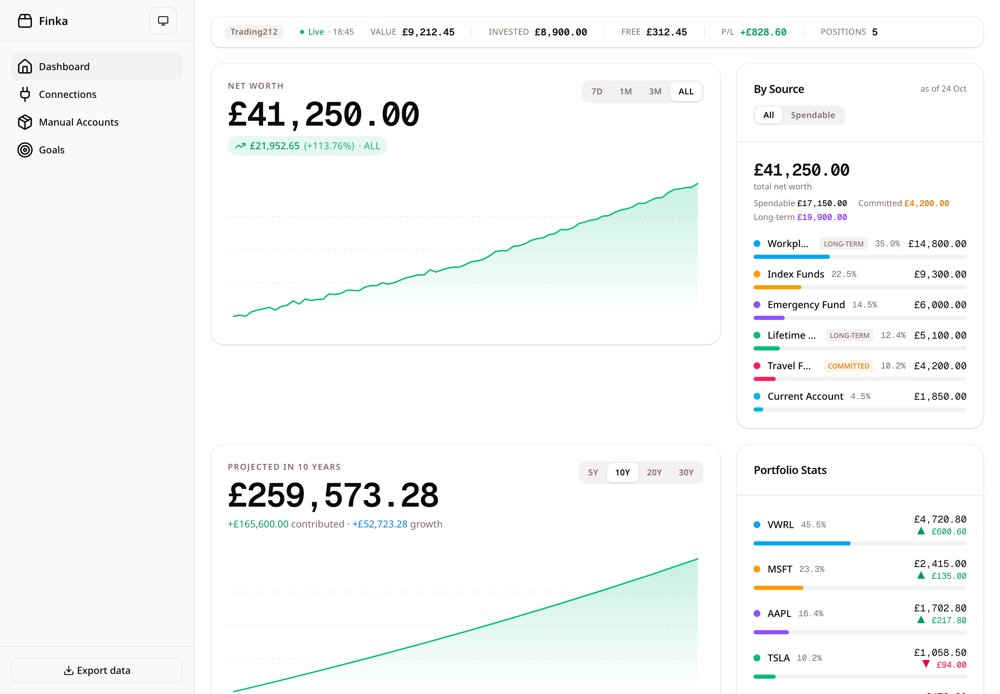
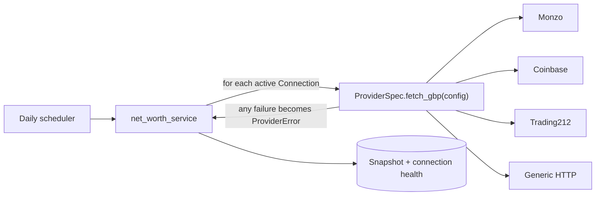

# Finka


<picture>
  <source media="(prefers-color-scheme: dark)" srcset="docs/screenshots/dashboard-dark.png">
  
</picture>

*Screenshot uses the built-in demo data (`./start.sh --demo`); the Trading212 panel is mocked.*

A self-hosted personal net-worth dashboard. You run it, you connect your own data
sources, and it tracks your total net worth over time — with a spendable-vs-locked
split and a savings projection.

Finka doesn't ship with any accounts wired in. **You bring your own sources.** If a
provider has a read-only API (or any endpoint that returns your balance as JSON),
Finka can poll it. For anything without an API, add a manual account and keep the
number up to date by hand.

---

## What you get

- **Net worth over time** — a daily snapshot of every connected source, charted.
- **By-source breakdown** — where your money actually is.
- **Spendable vs long-term** — flag locked assets (pensions, LISAs, anything you
  can't touch) so you can see what's actually available now.
- **Projection** — compound-growth forecast with monthly contributions.

---

## Why I built it

I was saving for a big goal with a deadline and kept checking my progress across several apps.
Finka started as a way to see that as one number instead of adding up several apps with a calculator.
Everything in it traces back to that:

- **Net worth graph.** One value for where I stand this month.
- **By source.** Which assets contribute most. Trading212 gets its own holdings panel
  so I can see which stocks are doing well.
- **Projection.** Seeing how far I've come shows where it could go. It uses growth
  rates and monthly contributions. Manual accounts take those two numbers directly;
  for connected accounts you enter them and Finka projects from today's balance.
- **Goals and spendable assets.** The projection looked too optimistic, especially
  with a stretch of time without income. Goals ring-fence money, so the spendable figure is
  honest.

---

## Key decisions

The full reasoning is in [ADR 0001](docs/adr/0001-provider-contract.md). In short:

1. **Local-first.** Finka was first designed for AWS (Cognito, RDS). I dropped that:
   hosting cost money, and bank credentials in the cloud are a risk. It now runs on
   your machine with Postgres in Docker.
2. **Providers are separate packages.** Core never names a bank. A source is a
   database row (provider + config), and each provider lives in its own package under
   [`integrations/`](integrations/), found through entry points.
3. **One failure-safe contract.** Every provider is called through
   `ProviderSpec.fetch_gbp`, which raises only `ProviderError`. One broken source
   cannot break a snapshot.

---

## How it works



- Each source you connect is a **Connection** row. The scheduler records one GBP
  figure per source, which the history chart and by-source breakdown read.
- `fetch_gbp` returns one value in pounds. That is what makes the figures summable.
  There is no FX: a provider converts to pounds itself, and the generic connector has
  a `multiplier` field for that.
- Everything runs against your own Postgres. Credentials and balances stay on your
  machine.

### When a source fails

1. The provider call raises, for example a timeout or a 401.
2. `fetch_gbp` rewraps it as `ProviderError`.
3. `net_worth_service` catches it, adds £0 for that source, and sets
   `last_status="error"` and `last_error` on the connection.
4. The snapshot is still saved, so **that day's total is understated**. The
   Connections page shows which source failed and why.

---

## Deferred

What Finka does not do yet, on purpose. See [docs/scope.md](docs/scope.md).

- **Real auth.** It is single-user by design; Cognito was removed.
- **Secrets at rest.** Provider credentials are stored as-is in the database.
- **Partial snapshots.** A failed source counts as £0 with no marker on the snapshot,
  and there is no fallback to the last known value.
- **Retry and backoff.** Only the Trading212 client retries on `429`.
- **Frontend lint.** CI builds the frontend but doesn't lint it yet: Biome reports
  about 60 mostly formatting errors in existing code.
- **FX conversion.** Only the `multiplier` workaround.
- **Third-party providers.** Providers are bundled in this repo. A documented way to
  install one from outside is future work.

---

## Prerequisites

| Tool | Version | Notes |
|------|---------|-------|
| Docker + Docker Compose | v2+ | Runs Postgres, the API and the frontend. On macOS, Colima works (`start.sh` starts it) |
| Node.js + npm | 20+ / 10+ | Only for [Manual setup](#manual-setup) |

---

## Quick start

```bash
git clone <your-fork-url> finka
cd finka
cp .env.example .env      # the defaults are fine for local use
./start.sh
```

`start.sh` starts Postgres, the API and the frontend in Docker, applies database
migrations and seeds the local user. When it's up:

- **App:** http://localhost:3000
- **API docs:** http://localhost:8000/docs

> **Do I need to edit `.env`?** No. The defaults run everything locally. You do
> **not** put any provider API keys in `.env` — credentials are added per-source
> through the app's **Connections** page (below), where they're stored in your
> database rather than a config file. The provider variables in `.env.example` are
> a legacy convenience (see [Seeding sources from `.env`](#optional-seeding-sources-from-env))
> and can be left blank.

### Try it with demo data

```bash
./start.sh --demo
```

Starts a separate copy with fictional accounts, 18 months of history and two goals, so
you can see the dashboard fully populated. It uses its own database, so it never
touches real data. Stop your normal stack first (both use the same ports). Remove it
with `COMPOSE_PROJECT_NAME=finka-demo docker compose down -v`.

If you'd rather not use `start.sh`, see [Manual setup](#manual-setup).

---

## Connecting your data

Open the app and go to the **Connections** tab. Every source you add starts
contributing to your net worth on the next sync.

### Option 1 — Generic HTTP connector (works with anything)

This is the general-purpose path: point Finka at **any URL that returns JSON with a
number in it**, and it polls that number as a GBP balance. Great for a bank/broker
with a read-only API, a self-hosted service, a crypto exchange, a spreadsheet
published as JSON — anything.

On the Connections page, pick **Generic HTTP (JSON)** and fill in:

| Field | What it is | Example |
|-------|-----------|---------|
| **URL** | The endpoint returning JSON | `https://api.example.com/v1/account` |
| **Value path** | Dotted path to the number in the response | `data.balance.amount` |
| **Method** | `GET` (default) or `POST` | `GET` |
| **Headers** | JSON object of headers, e.g. for auth (write-only/secret) | `{"Authorization": "Bearer YOUR_TOKEN"}` |
| **Multiplier** | Scales the value — e.g. `0.01` to turn pennies into pounds | `1` |

**Worked example.** Say your provider responds to `GET https://api.example.com/v1/account` with:

```json
{
  "status": "ok",
  "data": {
    "balance": { "amount": "12345.67", "currency": "GBP" }
  }
}
```

Then set **Value path** to `data.balance.amount`. Paths walk objects and arrays by
index — e.g. `accounts.0.balance` reads the balance of the first item in an
`accounts` array.

Hit **Test** before saving to confirm Finka can reach the endpoint and pull the
number. On success it shows the fetched value; on failure it tells you what went
wrong (bad path, auth rejected, not JSON, …).

> **Currency:** Finka treats the fetched number as GBP. There's no FX conversion —
> if your source is in another currency, either pre-convert it or set the
> **Multiplier** to an approximate rate.

### Option 2 — Named integrations

Finka also ships purpose-built connectors for a few providers. They appear in the
same **Provider** dropdown and ask for that provider's specific credentials (an API
key, a token, etc.) instead of a raw URL. Each field has inline help pointing to
where you generate the credential. Use these if your provider is in the list;
otherwise the Generic HTTP connector above covers it.

Adding a new named integration means a new package under [`integrations/`](integrations/)
that exposes a manifest on the `finka.providers` entry point, plus an entry in
[`core/pyproject.toml`](core/pyproject.toml). The registry then discovers it and it shows
up everywhere automatically (form, validation, aggregation). See
[ADR 0001](docs/adr/0001-provider-contract.md).

### Option 3 — Manual accounts

For anything without an API — a cash ISA, a pension you check quarterly, property —
use the **Manual Accounts** tab. You type the balance and update it whenever it
changes. Manual accounts support the same projection inputs (monthly contribution,
growth rate, annual charge) and the spendable/long-term flag.

---

## Using it

- **Secrets are write-only.** Once you save a connection, its secret fields (tokens,
  keys, auth headers) are never shown again — the app only tells you whether a
  secret is set. Editing a connection without re-entering a secret keeps the stored
  one.
- **Sync now.** Balances refresh on a daily snapshot, but you don't have to wait:
  the **Sync now** button on the Connections page re-polls every source immediately
  and updates the dashboard. Adding a source auto-syncs it.
- **Health.** Each connection shows its last sync status — the fetched value and
  time on success, or the error (e.g. an expired token) on failure. A source that
  fails contributes 0 and stays visible with the reason, rather than silently
  vanishing.
- **Spendable vs long-term.** Toggle any source or account to **Long-term** to
  exclude it from the "spendable now" figure while keeping it in total net worth.

---

## Manual setup

If you're not using `start.sh`:

```bash
# 1. Database + API (Docker)
docker compose up -d --build

# 2. Migrations
docker compose exec api alembic upgrade head

# 3. Frontend
cd frontend
npm install
npm run dev
```

- App: http://localhost:3000 · API: http://localhost:8000

Optionally seed a dev user and two sample manual accounts so the dashboard has
something to render:

```bash
docker compose exec api python scripts/seed.py
```

### Running the API outside Docker

Requires Python 3.11–3.13 and [uv](https://docs.astral.sh/uv/). Start Postgres on
its own (`docker compose up db -d`), or point `DATABASE_URL` at any Postgres 16.

```bash
cd core
uv sync                                  # install dependencies
uv run alembic upgrade head              # migrations
uv run uvicorn main:app --reload --port 8000
```

### Database management

| Task | Command (from `core/`) |
|------|-----------------------|
| Apply pending migrations | `uv run alembic upgrade head` |
| Roll back one migration | `uv run alembic downgrade -1` |
| Generate a migration | `uv run alembic revision --autogenerate -m "description"` |
| Reset to an empty DB | `uv run python scripts/reset.py` |

### Tests and linting

```bash
cd core
uv run pytest
uv run ruff check .

cd ../frontend
npm run lint
npx tsc --noEmit
```

---

## Optional: seeding sources from `.env`

If you'd prefer to configure a named provider's credentials as environment
variables instead of through the UI (e.g. for a scripted deploy), fill in the
relevant variables in `.env`, then run:

```bash
docker compose exec api python -m scripts.seed_connections
```

This creates connection rows from whatever provider variables are set. It's
idempotent — it skips a provider you already have a connection for — and is purely a
convenience; the UI is the normal way to add sources.

---

## Project layout

```
finka/
├── core/                    # FastAPI backend
│   ├── integrations/        # ProviderSpec contract + entry-point registry
│   ├── models/ routers/ services/ schemas/
│   ├── alembic/             # DB migrations
│   ├── scripts/             # seed, reset, snapshot, seed_connections
│   └── tests/
├── integrations/            # one package per provider
│   ├── monzo/
│   ├── coinbase/
│   └── trading212/
├── frontend/                # Next.js app
├── docs/                    # ADRs and scope
├── docker-compose.yml
└── start.sh                 # one-command local start
```
